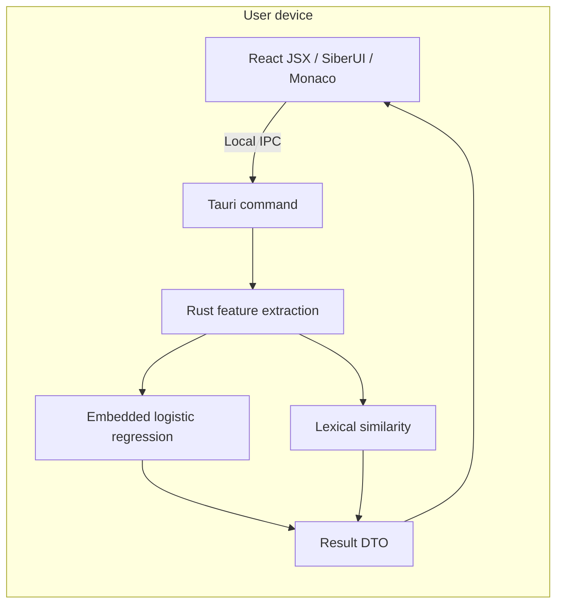

<p align="center"></p>

# Aivora Studio · Sovereign Engine

**Local machine learning for Python source-code similarity.**

Aivora Studio is a desktop application that compares two Python source files or pasted code blocks using a supervised classifier compiled directly into a Rust inference engine. The application combines a professional Monaco editing experience with a compact local execution architecture: no inference API, hosted model, database, Python runtime or GPU is required on the user's device.

**Built and benchmarked on macOS ARM64.** Windows and Linux are supported build targets; their native runtime validation remains separate.

| Test F1 | ROC-AUC | Native engine median | Rust CLI | Monaco executable |
| ---: | ---: | ---: | ---: | ---: |
| **81.53%** | **90.11%** | **88 µs** | **360.66 KiB** | **5.27 MiB** |

*450 held-out evaluation pairs; native parity passed. Executable sizes exclude OS-provided WebView and installer overhead. macOS measurements were supplied by the project team.*

## What it does

- Compare two Python inputs side by side with locally bundled Monaco, Python syntax highlighting, and the Aivora light theme.
- Display lexical similarity and the model's estimated probability of the similar class as separate percentages.
- Run feature extraction and prediction in Rust using Tauri IPC; source code is treated as data and is never executed.
- Validate input, limit each block to 64 KiB of UTF-8, handle errors, and discard stale results when input changes.
- Use the same dependency-free Rust inference core from either the desktop application or a standalone CLI.

## Architecture



Training is a separate development workflow using Python and scikit-learn. Learned values are exported to `engine/src/model.rs` and compiled into the application. Monaco, its worker, Python language support and Fontsource fonts are bundled by Vite rather than loaded from a CDN. Tauri uses the operating system's WebView. [Architecture details](docs/Architecture.md) · [Model card](docs/Model_Card.md) · [Validation and benchmark protocol](docs/Validation.md).

## Machine learning

The team evaluated four candidates using 3,000 balanced Python code pairs (2,100 training, 450 validation, 450 test). The selected model is logistic regression over eleven lexical and structural-proxy features. Thresholds were tuned on validation; the final model was chosen by estimated parameter footprint among supervised candidates within 0.02 F1 of the best validation score.

| Model | Validation F1 | Test F1 | Accuracy | Precision | Recall | ROC-AUC | Estimated parameter storage |
| --- | ---: | ---: | ---: | ---: | ---: | ---: | ---: | ---: |
| Bigram cosine baseline | 73.62% | 71.52% | 68.67% | 65.56% | 78.67% | 77.42% | 8 B |
| **Logistic regression** | 83.56% | 81.53% | 79.56% | 74.36% | 90.22% | 90.11% | 104 B |
| Compact random forest | 82.11% | 81.15% | 79.56% | 75.29% | 88.00% | 90.00% | 143,304 B |
| Full random forest | 82.38% | 82.82% | 81.56% | 77.52% | 88.89% | 90.01% | 1,003,096 B |

### Confusion matrix

Rows are actual classes; columns are predicted classes. Positive = similar; threshold = 0.35.

| Actual / predicted | Different | Similar |
| --- | ---: | ---: |
| Different | 155 (TN) | 70 (FP) |
| Similar | 22 (FN) | 203 (TP) |

358 of 450 classifications were correct. The model detects 203 of 225 positive pairs. The original AST/TF-IDF random forest reported 82.93% F1; the selected model is 1.40 percentage points below that historical baseline. The 80% accuracy target was missed by 0.44 percentage points.

### Why 104 bytes?

Eleven `f64` weights (88 B), one `f64` intercept (8 B), and one `f64` decision threshold (8 B) total **104 B of numerical values**. The learned coefficients themselves total 96 B. This is an estimated parameter footprint, not a measured binary section or the application size.

The classifier computes `z = b + sum(w[i] * x[i])`, then `p = 1 / (1 + exp(-z))`. If `p >= 0.35`, the predicted class is similar. The lexical score independently averages unigram, bigram and trigram cosine and token Jaccard, omitting n-gram orders absent from both inputs. Neither score is a plagiarism percentage or proof of semantic equivalence. The model probability is not calibrated.

## Performance

### Native engine

Measured on macOS 15.7.4 ARM64 using release builds and 450 evaluation pairs. The native parity gate passed.

| Measurement | Rust CLI | Python reference (Linux x86_64) |
| --- | ---: | ---: |
| Median per-pair processing | 88 µs | 518.86 µs |
| p95 | 199 µs | 1,206.23 µs |
| p99 | 301 µs | 1,814.95 µs |
| CLI executable | 369,312 B (360.66 KiB) | — |

The Rust median is from the repeat run. The first run measured 87.5 µs median and 2.29 ms median process launch plus a short comparison. The observed cross-host latency difference is descriptive, not a controlled language comparison. The Rust timer uses integer microseconds; an inference measurement of zero indicates limited resolution, not zero computation.

### Desktop application

Five alternating launches per variant on the same Mac; all ten reached the readiness marker.

| Measurement | Tauri + textarea | Tauri + Monaco |
| --- | ---: | ---: |
| Release executable | 4.57 MiB | **5.27 MiB** |
| Median time to editors ready | 365.52 ms | **737.85 ms** |
| Median sampled peak process-tree RSS | 82.84 MiB | **93.08 MiB** |
| Median accumulated process-tree CPU | 0.236 s | **0.205 s** |
| Successful launches | 5/5 | 5/5 |

Monaco adds 743,040 bytes (725.63 KiB), approximately 15.52% of the textarea executable size, and 10.23 MiB to median sampled peak RSS. We selected Monaco for its editing capabilities. CPU measurements are descriptive; the short test does not establish a CPU advantage. GUI readiness includes editor mounting, fonts, two animation frames and IPC; it is not guaranteed cold startup. Shared WebView processes can fall outside the sampled process tree. Installer sizes and offline GUI verification are not yet recorded in the evidence.

## Getting started

### Prerequisites

- Stable Rust / Cargo and Node.js 22 (development only).
- [Tauri 2 platform prerequisites](https://v2.tauri.app/start/prerequisites/): macOS Xcode command-line tools; Windows MSVC build tools and WebView2; Linux WebKitGTK 4.1 and distribution-specific libraries.
- Access to `@siberui/react` through the project's npm registry configuration. Use the version and registry that your team validated; never commit registry credentials.
- Python 3 and an isolated virtual environment only for training or benchmarking.

Run commands from the repository root. If using a source archive, extract it and open its root directory first.

```sh
cargo test --manifest-path engine/Cargo.toml
cargo run --release --manifest-path engine/Cargo.toml -- parity results/parity.tsv
npm install
npm run tauri dev
```

The repository's existing package manifest uses a wildcard for SiberUI. Before publishing a release, pin the known-working version and commit the lockfiles generated from the actual build. If a committed npm lockfile exists, prefer `npm ci` instead of `npm install`.

### Build the desktop application

```sh
npm run tauri build
```

The default build includes Monaco. For a release executable without installer generation:

```sh
npm run tauri build -- --no-bundle
```

Tauri produces target-specific artifacts. A macOS ARM64 binary is not a universal Windows/Linux executable. The initial dependency installation requires network access or a populated cache; inference does not require a remote model service.

### Run the standalone engine

```sh
cargo build --release --manifest-path engine/Cargo.toml
cargo run --release --manifest-path engine/Cargo.toml -- compare examples/original.py examples/comparison.py
```

The CLI returns JSON with similarity, confidence, predicted class, threshold and processing timings. The built executable is `engine/target/release/sovereign-engine` (`.exe` on Windows).

### Reproduce the training experiment

Only run this when intentionally regenerating the model: it rewrites the exported parameters, metrics and parity vectors. The existing exported model is ready for inference without retraining.

```sh
python3 -m venv .venv
source .venv/bin/activate
python -m pip install -r training/requirements.txt
python training/train.py
cargo test --manifest-path engine/Cargo.toml
cargo run --release --manifest-path engine/Cargo.toml -- parity results/parity.tsv
```

On Windows PowerShell use `py -3 -m venv .venv` and `.venv\Scripts\Activate.ps1` (or invoke the environment's Python directly). Original partitions are checked for overlapping source hashes and groups. See `results/metrics.json` for the actual model-selection results.

### Run benchmarks

```sh
python -m pip install psutil
cargo build --release --manifest-path engine/Cargo.toml
python benchmarks/reference_benchmark.py
python benchmarks/benchmark.py
node benchmarks/build_variants.mjs
python benchmarks/gui_benchmark.py --textarea benchmark-builds/textarea/release/python-similarity-detector --monaco benchmark-builds/monaco/release/python-similarity-detector
```

Add `.exe` to the GUI executable paths on Windows. Close other instances before measurement. The scripts emit CSV/JSON under `results/`; `benchmark.py` also supports `--app` and `--package` to measure a specific executable and installer. The reference benchmark uses the exported logistic formula and Python's standard library; run it on the same host as Rust for a controlled comparison. The reported macOS evidence is included separately so that new runs do not overwrite it.

## Repository layout

```text
engine/        # Rust library, CLI, embedded model
src/           # React JSX, local Monaco, Aivora styles
src-tauri/     # Desktop shell, IPC, bundling and permissions
public/brand/  # Aivora SVG assets
training/      # Dataset, historical notebooks, features and training
benchmarks/    # Reference, native and GUI measurement scripts
results/       # Evaluation metrics and parity fixtures
examples/      # Example Python input files
docs/          # Research paper, model card, diagrams and guides
legacy/        # Original Ruff-based lexer and frontend
.github/       # Cross-platform verification workflow
```

## Validation and platform support

| Area | Evidence |
| --- | --- |
| Supervised model | 450-pair test evaluation; 81.53% F1 |
| Rust parity | Passed on 450 pairs on macOS ARM64 |
| macOS native build | CLI and both Tauri release executables built; GUI readiness 10/10 |
| Windows / Linux | Build targets; native runtime results not yet recorded |
| Offline GUI | Locally bundled by design; disconnected-network run not yet recorded |
| CI / distribution | Workflow included; signed installers, CI status and package sizes not claimed |

The project demonstrates native deployment feasibility. It is not a claim of audited production security or universal platform certification. For release operations, use [the release checklist](docs/Release_Checklist.md).

## Privacy, security and limitations

 The Tauri CSP restricts connections to local IPC; the OS, clipboard, WebView and third-party dependencies remain part of the trust boundary. A separate offline smoke test is required to document network independence. No accounts, external inference APIs or telemetry service are required.

The lightweight lexer is approximate; it does not validate Python grammar, build an AST, or prove semantic equivalence. Identifiers and literals are normalized, so meaningful behavioral differences can be hidden. False positives and false negatives are expected. Use scores as review signals, not as an automated plagiarism verdict.  independent external validation is needed for generalization claims.

## Documentation

- [Research paper (PDF)](docs/Aivora_Research_Paper.pdf) and [editable Word version](docs/Aivora_Research_Paper.docx)
- [Technical architecture](docs/Architecture.md) and [technical guide (PDF)](docs/Aivora_Technical_Guide.pdf)
- [Model card](docs/Model_Card.md), [validation protocol](docs/Validation.md), and [release checklist](docs/Release_Checklist.md)

## Authors

Lou Parra · Luis Adrián Díaz · Ana Flores · Joselyn Espinoza  
Tecnológico de Monterrey · Applied research project · 2026


---

**Aivora AI Intelligence without inference infrastructure.**
