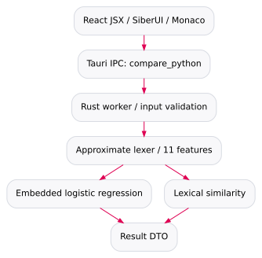
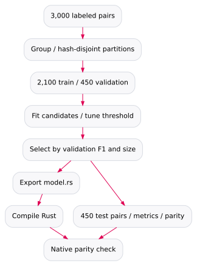
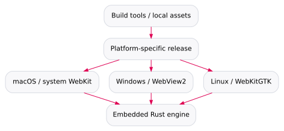
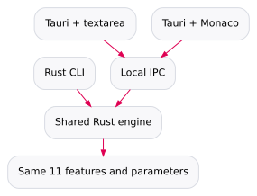

# Architecture · Aivora Studio

Aivora Studio uses a modular desktop monolith. React JSX and SiberUI render the UI. Two independent Monaco models provide Python editing. Tauri 2 invokes a local Rust command and schedules the CPU-bound comparison on a blocking worker. The engine is a separate dependency-free Rust library and CLI; no Python or external inference process is launched.

## Components



## Inference sequence

```mermaid
sequenceDiagram
    actor U as User
    participant R as React + Monaco
    participant T as Tauri IPC
    participant E as Rust engine
    participant M as Embedded model
    U->>R: Paste original and comparison; run analysis
    R->>T: invoke compare_python
    T->>E: spawn_blocking
    E->>E: Validate inputs and compute 11 features
    E->>M: predict(features)
    M-->>E: Similar-class probability estimate
    E-->>T: Similarity, confidence, class, timing
    T-->>R: Result DTO
    R-->>U: Display results if revision remains current
```

IPC input: `{original: string, comparison: string}`. Each input must be no more than 64 KiB UTF-8 and contain at least one token after comment/whitespace removal. Output (camelCase): `similarity`, `confidence`, `predictedSimilar`, `threshold`, `elapsedMs`, `model`. Scores are 0–1; the UI formats percentages. `elapsedMs` is engine time, not UI end-to-end latency. Errors are returned as strings; a failed request does not overwrite a newer revision.

## Training and export



Development uses Python and scikit-learn; `training/train.py` verifies disjoint hash/group sets, trains candidates, tunes decision thresholds using validation F1, exports the selected model, and generates `results/metrics.json`, `metrics.csv` and `parity.tsv`. Runtime code imports no ML framework.

## Deployment



Builds are platform-specific. The released frontend embeds local assets, font packages and Monaco worker; the operating system supplies the WebView. The CSP allows self resources and local IPC, not an external model API. The opt-in `benchmark_ready` command writes only a variant marker to a path supplied by `AIVORA_BENCH_READY`; it is not telemetry.

## Benchmark isolation



The CLI and both desktop variants share the same engine. The textarea mode omits the dynamic Monaco import. Benchmark binaries are separate from installer packages. Measured macOS release readiness succeeded for both GUI variants; offline functionality and other OS runtime tests remain separate validation activities.

Editable Graphviz DOT, SVG and PNG files accompany these diagrams. See [Validation](Validation.md) for benchmark methodology.
